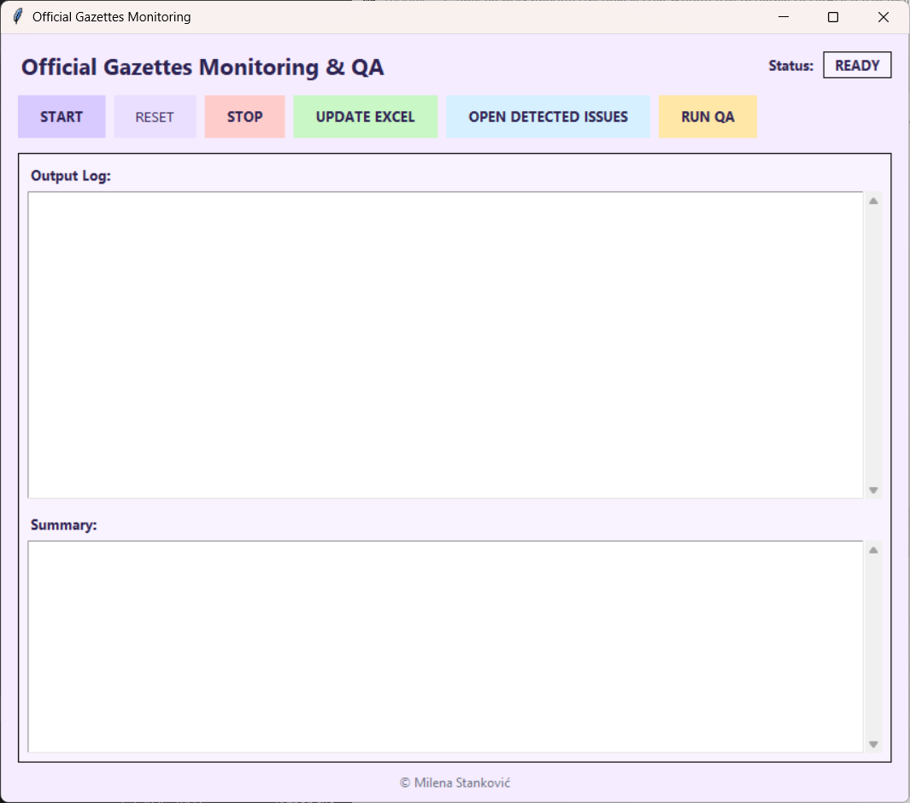

# Official Gazettes Monitoring & QA Platform

📌 **Project Type:** Internal Business Automation

💻 **Platform:** Windows Desktop

🐍 **Language:** Python

⚙️ **Application:** Desktop GUI

✅ **Status:** Production Use

## Overview

Official Gazettes Monitoring & QA is a centralized Python-based platform for monitoring and managing official gazette workflows across dozens of independent publication sources.

The platform orchestrates production scripts, detects newly published issues by comparing website data with existing Excel records, provides real-time execution feedback, and supports direct access to sources where new issues have been identified.

An independent QA layer performs a separate verification cycle to detect website changes, structural irregularities, and discrepancies that may not be identified by the production automation.

## Business Problem

As the number of monitored official gazette sources and automation scripts increased, managing them individually became increasingly inefficient and difficult to control.

The workflow previously required repeated manual visits to numerous websites, checking issue numbers against existing records, locating the relevant publication pages, and updating the tracking file manually.

Changes in website structures, issue-number formats, loading behavior, and publication layouts also created a risk that production scripts could return incomplete or outdated results without the problem being immediately visible.

A centralized solution was therefore needed to coordinate execution, maintain a reliable tracking record, simplify access to newly detected issues, and independently verify production results.

## Challenges Solved

The platform was developed through production-driven improvements, each addressing a specific operational or technical challenge.

Major challenges included:

- Coordinating dozens of production and QA scripts through a single desktop interface.
- Monitoring heterogeneous websites with different structures, publication formats, and navigation patterns.
- Reliably detecting new issue numbers by comparing current website data with existing Excel records.
- Supporting variations in numbering formats, character sets, and Unicode text.
- Preventing new entries from overwriting or rebuilding the existing tracking file.
- Opening only the sources where new issues were detected instead of requiring manual bookmark navigation.
- Managing slow-loading, inconsistent, or temporarily unavailable websites.
- Providing clear real-time execution feedback while multiple scripts are processed sequentially.
- Separating production monitoring from independent QA verification.
- Detecting structural website changes and irregularities before they affect the wider workflow.
- Designing the system so that individual source scripts can be updated independently.

## Solution

The desktop application provides a unified control layer for the entire monitoring workflow.

The **START** action launches the production scripts, which visit the configured official gazette websites, retrieve the currently published issue numbers, and compare them with the records stored in the existing Excel file.

When new issues are found, the platform displays them in the summary and stores the corresponding source links for further processing.

The **OPEN DETECTED ISSUES** action opens only the relevant publication pages where new issues were identified, eliminating the need to search manually through browser bookmarks.

The **UPDATE EXCEL** action appends confirmed new issue numbers to the existing tracking records without overwriting previous data or recreating the workbook.

The **RUN QA** action launches a separate set of verification scripts. These scripts independently inspect the publication sources and report structural changes or irregularities that may have remained undetected during the production run.

## QA Modernization & Performance Optimization

The platform's independent QA layer was modernized to improve execution efficiency, maintainability, and diagnostic accuracy while preserving existing production functionality.

The modernization covered 35 independent QA modules, using a hybrid approach based on Requests, BeautifulSoup, and Selenium WebDriver, depending on the technical requirements of each publication source.

Key improvements include:

- Optimized 35 source-specific QA modules while preserving established validation rules and website-specific handling.
- Replaced unnecessary browser automation with direct HTTP requests and HTML parsing where technically appropriate.
- Standardized QA reporting to distinguish successful checks, structural changes, temporary source unavailability, and QA execution errors.
- Maintained independent QA modules that can be updated without rebuilding the desktop GUI application.
- Preserved the separation between production monitoring and independent quality verification.

### Measured Performance Improvement

| Metric | Before | After |
|---|---|---|
| QA execution time | 5 min 24 sec | 1 min 44.86 sec |
| QA modules | 34 | 35 |
| Execution speed | Baseline | 3.09× faster |
| Execution time reduction | — | 67.6% |

All 35 QA modules successfully passed individual functional testing following modernization.

The optimization significantly reduced execution time while retaining the existing production architecture and source-specific verification logic.

## Business Impact

- Centralized the management of a growing collection of production and QA automation scripts.
- Replaced repeated manual checking across dozens of official gazette websites.
- Reduced the risk of missed publications through an independent verification layer.
- Enabled direct access to only those sources where new issues were detected.
- Automated safe updates to the existing Excel tracking records.
- Improved visibility through real-time execution logs and concise action summaries.
- Enabled earlier detection of website changes and automation discrepancies.
- Simplified maintenance by keeping source-specific logic in independent modules.
- Reduced repetitive navigation, comparison, and data-entry work.
- Reduced the complete QA verification cycle by 67.6%, from approximately 5 minutes 24 seconds to 1 minute 45 seconds.
- Improved QA maintainability and diagnostic consistency through standardized reporting and optimized source-specific verification modules.

## Key Features

- Centralized desktop GUI
- Production-script orchestration
- Independent QA verification across 35 source-specific modules
* Standardized QA status reporting and error classification
- Monitoring across dozens of official gazette sources
- Automatic detection of newly published issues
- Comparison with existing Excel records
- Safe appending of new issue numbers
- Direct opening of detected publication sources
- Real-time execution log
- Action summary and irregularity reporting
- Script execution and process control
- Stop and reset functionality
- Excel backup support
- Modular source-specific architecture

## Technologies

- Python
- Tkinter
- Selenium WebDriver
- openpyxl
- Regular Expressions
- Unicode normalization
- BeautifulSoup
- Requests
- Multithreading and thread-safe queues
- Subprocess and process-tree management
- Browser automation
- Windows Desktop Automation

The project currently includes 72 Python files organized across its production, QA, orchestration, and interface layers, using a combination of browser automation, HTTP-based data retrieval, HTML parsing, and desktop workflow automation.

## Notes

This project was developed for internal business workflow automation and is used with source-specific production and QA modules.

The repository intentionally excludes source code because it contains organization-specific business logic, internal tracking structures, and automation workflows.

Screenshots and documentation are provided to demonstrate the platform’s functionality, architecture, verification model, and business impact.

## Portfolio

This project is part of a broader portfolio focused on business process automation, document processing, quality assurance, and workflow optimization using Python.
